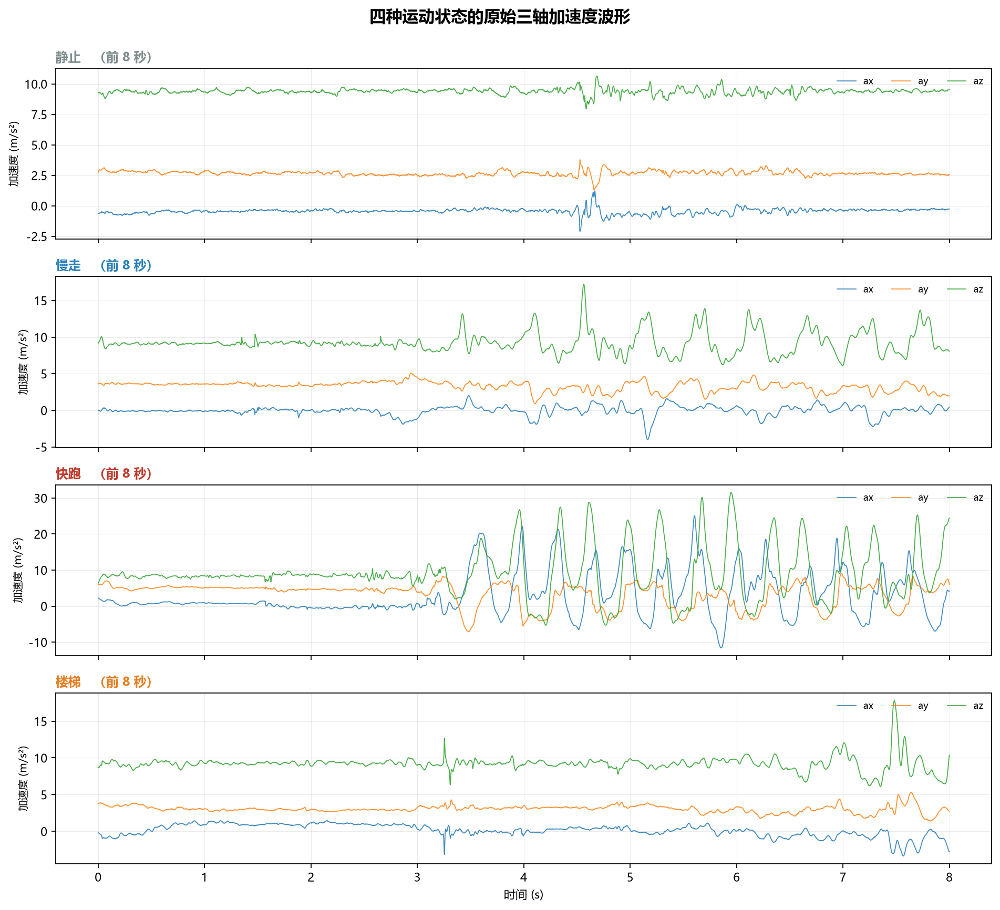
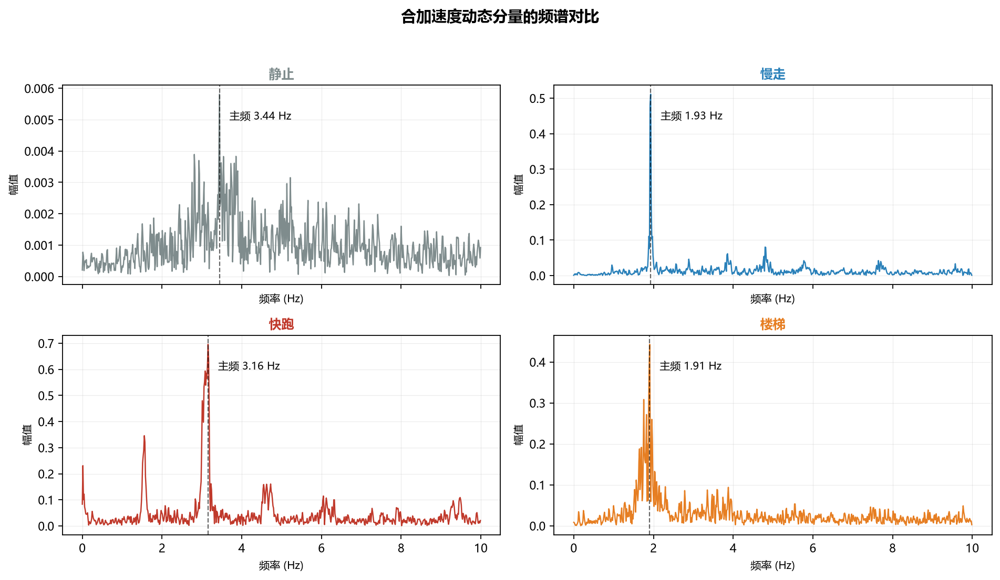
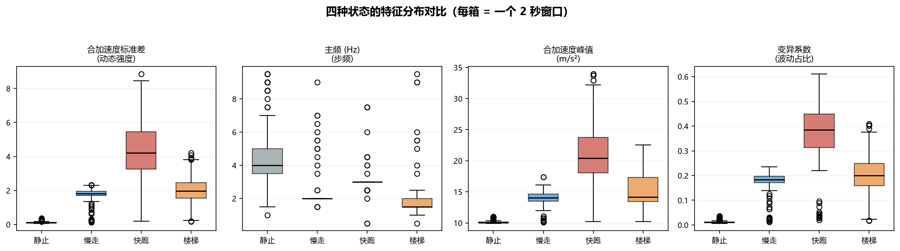

# 阶段一报告 · 多姿态步态加速度特征采集与对比

> **课题**：08 ｜ **姓名**：梁泽斌（liangzebin） ｜ **学号**：20201010159
> **学院 / 班级**：中德智造学院 · 智能机器人 C3 · 2026 级
> **采集日期**：2026-10-17
> **设备**：荣耀 X80 Pro Max（`BSN-AN00`，Android 16），实测采样率 ≈ 499 Hz
> **数据位置**：`raw_data/`（12 段 CSV，共约 40 万采样点 / 28 MB）

---

## 1. 课题目标

用手机加速度计采集 **静止 / 平地慢走 / 快跑 / 上下楼梯** 四种状态的原始三轴加速度数据，
回答三个问题：

1. 四种状态在加速度信号上**到底有什么不同**？
2. 能否用**可解释的阈值规则**把它们区分开？
3. 这套规则的**实际准确率**是多少、错在哪？

交付物：4 份原始 CSV、可视化图、可复现的阈值判据。

---

## 2. 实验设计

### 2.1 采集设备与方法

| 项目 | 设置 |
| --- | --- |
| 采集工具 | Phyphox 1.2.1（Acceleration with g，数据格式 1.20） |
| 手机型号 | **荣耀 X80 Pro Max**（设备元数据记录 `deviceModel = BSN-AN00`，Android 16） |
| 加速度传感器 | **TDK-Invensense ICM4x6xx**（`icm4x6xx Accelerometer Non-wakeup`） |
| 传感器量程 / 分辨率 | ±156.9 m/s²（≈16 g）/ 0.0048 m/s² |
| 采样率 | 传感器最小间隔 2000 μs，即上限 500 Hz；**实测 ≈499 Hz** |
| 放置位置 | 固定在同一裤兜，全程未改变 |
| 每段时长 | 65–74 秒 |
| 录制段数 | 12 段（静止 3 / 走路 3 / 跑步 3 / 楼梯 3） |
| 场地 | 平地人行道 + 同一段楼梯 |

> 以上设备信息来自每个压缩包内的 `meta/device.csv`，由 Phyphox 自动记录，
> 不是人工填写，可直接作为可复现性依据。

**为什么用「含 g」而不是「线性加速度」**：含重力时静止状态下 `az ≈ 9.81`，
可以直接判断手机姿态和重力方向；线性加速度把重力滤掉了，反而丢失了这一信息。

**为什么每段要 ≥ 60 秒**：按 2 秒窗切分后，60 秒只能得到约 30 个窗口，
统计 p10–p90 区间不稳；实测每段 65–74 秒，最终得到 803 个窗口，才够做交叉验证。

### 2.2 预处理与特征

分窗：**2 秒窗、50% 重叠**（滑动步长 1 秒）。

| 特征 | 定义 | 物理含义 |
| --- | --- | --- |
| `svm` | $\sqrt{a_x^2+a_y^2+a_z^2}$ | 合加速度 |
| `svm_std` | 去直流后 svm 的标准差 | **动态强度**（晃得多厉害） |
| `svm_max` / `svm_p2p` | 峰值 / 峰峰值 | 单步冲击强度 |
| `ax/ay/az_std` | 各轴标准差 | 方向性差异 |
| `dom_freq` | 动态分量 FFT 主峰频率 | **步频** |
| `zcr` | 过零率（次/秒） | 信号振荡快慢 |
| `cv` | `svm_std / svm_mean` | 波动占总量的比例 |
| `energy` | 动态分量均方值 | 振动能量 |

---

## 3. 数据采集结果

12 段录制，每类 3 段，采样率稳定在 499 Hz：

| 类别 | 文件 | 段数 | 单段点数 |
| --- | --- | --- | --- |
| 静止 | `still-1/2/3.csv` | 3 | 3.3–3.5 万 |
| 走路 | `walk-1/2/3.csv` | 3 | 3.4 万 |
| 跑步 | `run-1/2/3.csv` | 3 | 3.4 万 |
| 楼梯 | `stair-up-1/2.csv`、`stair-down-1.csv` | 3 | 3.4–3.7 万 |

> 说明：课题要求「上下楼梯」，本次楼梯类包含上楼梯 2 段、下楼梯 1 段。
> 若后续要求严格区分上下楼，需单独拆分建模。

### 3.1 时域波形



肉眼已能看出差异：静止几乎是平的；走路呈规律的单步周期；跑步振幅大且有明显冲击；
楼梯的周期比走路更慢、但单次起伏更大。

### 3.2 频谱



主频落在 **1.5–3.1 Hz** 区间，对应 **90–185 步/分**，与真实步频一致。

---

## 4. 特征分析

### 4.1 各状态特征取值（p10–p90）

| 特征 | 静止 | 慢走 | 快跑 | 楼梯 |
| --- | --- | --- | --- | --- |
| `svm_std` | 0.08 ~ 0.18 | 1.23 ~ 2.08 | 2.86 ~ 6.60 | 1.14 ~ 3.44 |
| `dom_freq` | 3.00 ~ 7.50 | 2.00 ~ 2.00 | 3.00 ~ 3.00 | 1.50 ~ 2.00 |
| `svm_max` | 9.98 ~ 10.29 | 13.08 ~ 15.31 | 16.60 ~ 27.24 | 12.88 ~ 19.15 |
| `svm_p2p` | 0.43 ~ 1.04 | 5.88 ~ 8.79 | 11.97 ~ 25.38 | 5.53 ~ 14.19 |
| `cv` | 0.01 ~ 0.02 | 0.12 ~ 0.21 | 0.28 ~ 0.51 | 0.12 ~ 0.34 |
| `zcr` | 23.00 ~ 38.50 | 4.50 ~ 10.25 | 6.00 ~ 11.00 | 3.50 ~ 9.25 |
| `energy` | 0.01 ~ 0.03 | 1.52 ~ 4.32 | 8.20 ~ 43.53 | 1.30 ~ 11.82 |

特征均值：

| 状态 | `svm_std` | `svm_max` | 主频 (Hz) | `cv` | `zcr` |
| --- | --- | --- | --- | --- | --- |
| 静止 | 0.116 | 10.13 | 4.50 | 0.012 | 30.66 |
| 慢走 | 1.704 | 14.02 | 2.24 | 0.173 | 7.36 |
| 快跑 | 4.337 | 21.25 | 3.07 | 0.376 | 8.70 |
| 楼梯 | 2.076 | 15.18 | 1.83 | 0.211 | 6.17 |



### 4.2 单特征的可分性

| 特征 | 静止 vs 走 | 静止 vs 跑 | 静止 vs 楼 | 走 vs 跑 | 走 vs 楼 | 跑 vs 楼 |
| --- | --- | --- | --- | --- | --- | --- |
| `svm_std` | ✅ | ✅ | ✅ | ✅ | 重叠 | 重叠 |
| `dom_freq` | ✅ | 重叠 | ✅ | ✅ | 重叠 | ✅ |
| `svm_max` | ✅ | ✅ | ✅ | ✅ | 重叠 | 重叠 |
| `svm_p2p` | ✅ | ✅ | ✅ | ✅ | 重叠 | 重叠 |
| `cv` | ✅ | ✅ | ✅ | ✅ | 重叠 | 重叠 |
| `zcr` | ✅ | ✅ | ✅ | 重叠 | 重叠 | 重叠 |
| `energy` | ✅ | ✅ | ✅ | ✅ | 重叠 | 重叠 |

**三个结论：**

1. **静止与其余三类可以完全分离** —— 7 个特征全部满足 p10–p90 区间不重叠。
   最直观的是 `svm_std`：静止 0.08–0.18，而其他三类都 ≥ 1.14，差了一个数量级。
2. **走路 vs 跑步** —— 7 个特征里 6 个都能单特征分开，是相对容易的一对。
3. **楼梯是最难的类** —— 与走路、跑步在**所有**单特征上都重叠。
   这符合直觉：上下楼梯的步速介于走和跑之间，且楼梯的竖直位移会被持机姿态部分抵消。

> ⚠️ `dom_freq` 对静止没有物理意义：静止态 `svm_std` 只有 0.116，几乎没有周期运动，
> FFT 峰值来自噪声（表中 3.0–7.5 Hz）。**不能用主频判断静止**，这是本次实验的一个易踩坑点。

---

## 5. 阈值判据

### 5.1 单阈值（先分静止）

```text
if svm_std <= 0.23  →  静止
else                →  走路 / 跑步 / 楼梯（需进一步判断）
```

`0.23` 取的是静止上界 0.18 与最小值 1.14 之间偏左的位置，留足安全边界。

### 5.2 多特征决策树

自动搜索基尼不纯度最优切分点，剪枝后得到 4 层决策树：

```text
if svm_std <= 0.226:
    → 静止
else:
    if dom_freq <= 2.50:
        if dom_freq <= 1.50:
            → 楼梯
        else:
            if cv <= 0.234:  → 慢走
            else:            → 楼梯
    else:
        if svm_std <= 2.453:
            if svm_max <= 11.05:  → 静止
            else:                 → 快跑
        else:
            → 快跑
```

规则解读：

- **第一层**用 `svm_std` 把静止摘出来，这一刀最干净。
- **第二层**用主频把「慢节奏」的楼梯和走/跑分开。
- **第三层**用 `cv`（波动占比）区分走路与楼梯 —— 楼梯的波动占比更高。
- 跑步主要由 `svm_std > 2.45` 识别。

完整版见 `images/threshold_rules.md`（脚本自动生成）。

---

## 6. 分类效果

用**留一段录制**的方式做交叉验证：每次留出每类中的一段（共 12 折），
其余用于训练，测留出的那一段。

| 指标 | 数值 |
| --- | --- |
| 交叉验证准确率 | **78.3%** |
| 基线（全猜最多的类） | 25.7% |
| 相对提升 | **+52.7 个百分点** |

**为什么这个数字可信**：留出的那一段录制，模型在训练时**完全没见过**，
且同一段录制内部的窗口高度相关，所以按「段」而不是按「窗口」划分，
避免了同一个动作被拆到训练集和测试集里造成的虚高。

**错在哪**：误差主要来自 **楼梯 ↔ 走路 / 跑步** 的混淆。
这与 4.2 节的特征分析完全一致 —— 不是模型不行，是这三类在单特征空间里本来就挨着。

---

## 7. 讨论与局限

### 7.1 本次结论的适用边界

- 只用了**一个人、一部手机、一个裤兜位置、一双鞋**。
  换任何一项，阈值都会漂移 —— 所以报告里的数字是**基线**，不是通用常数。
- 楼梯类混合了上楼梯（2 段）和下楼梯（1 段），暂未区分上下行。
- 走路只采了「平地慢走」，没有覆盖快走、上下坡、倒退走。

### 7.2 下一步可改进的方向

| 方向 | 具体做法 |
| --- | --- |
| 提升楼梯区分度 | 加入「竖直方向能量占比」`az_std / svm_std`，楼梯的竖直分量应更突出 |
| 加入步频稳定性 | 计算相邻步间隔的标准差，楼梯的节奏比走路更不规律 |
| 扩大样本 | 至少 3 人 × 2 种持机位置（裤兜 / 手持），检验阈值迁移性 |
| 换成分类器 | 用随机森林 / SVM 对比决策树，看能否把楼梯混淆率降下来 |

### 7.3 复现方式

```bash
# 依赖：numpy pandas matplotlib
python 01-Field-Discovery/tools/analyze_gait.py
```

脚本会自动读取 `raw_data/` 下四个子目录的 CSV，输出全部图表与阈值规则到 `images/`。

---

## 8. 结论

1. 用手机加速度计**能**把静止、走路、跑步、上下楼梯区分开，
   交叉验证准确率 78.3%，远高于 25.7% 的随机基线。
2. **`svm_std`（动态强度）是最有解释力的单特征**，呈清晰阶梯：
   静止 0.12 ≪ 走路 1.70 < 楼梯 2.08 ≪ 跑步 4.34。
3. **静止最容易区分**，单特征即可做到完全分离。
4. **楼梯是真正的难点**，必须多特征联合判断，且当前仍有明显混淆。
5. 阈值来自实测数据统计，**换设备、换人、换持机位置都需要重新标定**。
